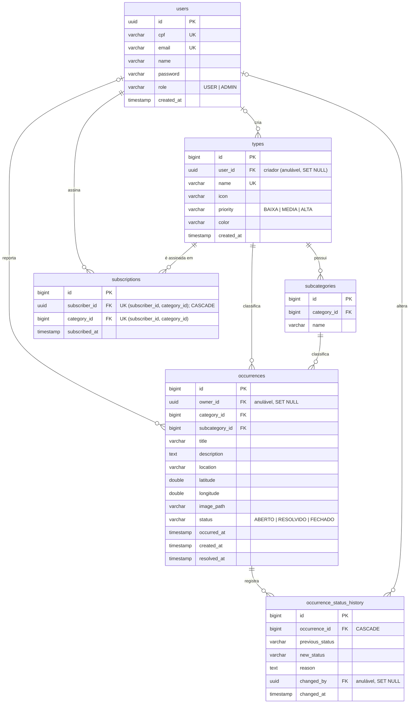

# Diagrama do Banco de Dados — Talkie

Modelo entidade-relacionamento do PostgreSQL, derivado das migrations Flyway `V1` a `V9`
(`backend/src/main/resources/db/migration/`).

## Tabelas

| Tabela | Entidade JPA | Descrição |
|--------|--------------|-----------|
| `users` | `User` | Usuários do sistema (cidadãos e administradores). |
| `types` | `Category` | Categorias de ocorrência, com prioridade, cor e ícone. |
| `subcategories` | `Subcategory` | Subdivisões de uma categoria. |
| `occurrences` | `Occurrence` | Problemas reportados pelos cidadãos. |
| `subscriptions` | `Subscription` | Assinatura de um usuário em uma categoria (gera notificações por e-mail). |
| `occurrence_status_history` | `OccurrenceStatusHistory` | Eventos de criação e mudança de status, com motivo e autor. |

## Observações

- `subscriptions` tem restrição `UNIQUE (subscriber_id, category_id)`: um usuário assina cada categoria uma única vez.
- `occurrences.category_id` e `occurrences.subcategory_id` são FKs independentes: nem o banco nem o `OccurrenceService` verificam hoje se a subcategoria pertence à categoria informada.
- `subscriptions.subscriber_id` e `subscriptions.category_id` são anuláveis no schema, embora a aplicação sempre os preencha.
- O usuário administrador inicial é inserido pela migration `V7`.
- Ao excluir uma conta, as referências em `occurrences`, `types` e `occurrence_status_history` viram `NULL` e as assinaturas são apagadas (ver `EXCLUSAO_DE_CONTA.md`).
